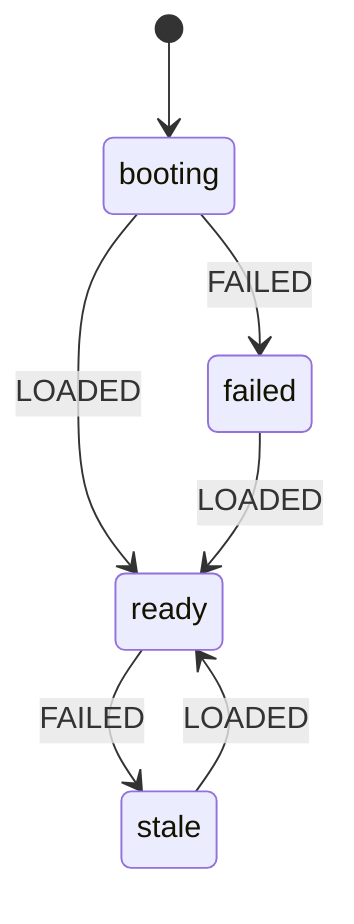

# Time Clock: handoff notes

Read this before changing anything. It describes the app as it is on this branch.

> **History:** the first version of this app was a single `index.html` backed by Supabase. It was replaced by the current app (commit "Add the Time Clock app."). The old version is still in git history and on the `state-machines` branch. The Supabase project `team-time-clock` is **not used** by this app.

---

## 1. What the app does

A time clock for a small team (about 9 people: 3 admins, 6 employees). It must stay **very easy to use** and **fully bilingual (English / Spanish)**.

**Sections.** The app is split into sections chosen from a side menu (left column on wide screens; a **Menu** button that opens a drawer on phones). The section is kept in the address (`#clock`, `#timeoff`, `#calendar`, `#daysoff`, `#team`, `#invite`, `#reports`), so a refresh or a bookmark opens it.

| Group | Section | What is there |
|---|---|---|
| You | Clock | The clock button, hours today / this week / this pay period, PTO days left, recent shifts, the next-day-off notice |
| You | Time off | Request a day off, my requests |
| Everyone | Calendar | Month calendar of closures and approved time off; "Request this day" opens Time off with the day filled in |
| Everyone | Company days off | **Every day the shop is closed, in date order**, with past ones folded away; admins add or remove days here and switch federal holidays on or off (with arrows to move between years) |
| Admin | Team | Each person: hours, PTO, shifts, role |
| Admin | Invite people | Invitations and who has not joined yet |
| Admin | Reports | Pay-period hours, PTO, missed punches, downloads |

**Everyone**
- Signs in with email and password (or Google / X); "Forgot your password?" emails a reset link
- One big **Clock in / Clock out** button
- Sees hours today, this week (Monday–Sunday) and this pay period (worked hours plus approved PTO), and PTO days left this year
- Requests PTO **one whole day at a time** (each day is paid as 8 hours; no hours box), and can cancel a request while it is pending, or an approved one until the day has passed
- Sees a shared calendar of shop closures and approved days off (pending requests stay private)

**Admins** also get a **Team** tab
- Who is on the clock, hours this week and last week, pending request counts
- Per person: approve or deny PTO, **Undo** a decision (back to pending), set **PTO days per year**, clock someone out, add a missed shift (16 hours max), delete a shift, make someone an admin or employee
- Add and delete shop closures on the calendar
- **Reports** tab: hours for everyone in a pay period (week 1, week 2, PTO days, total to pay, PTO days left), missed punches, and two spreadsheet downloads (hours per person, every shift). Arrows move between pay periods.
- **Invite people** by email with a role (employee or admin); see who has not joined yet, copy the link, send again, or remove the invitation
- **Federal holidays:** the 11 US federal holidays are listed for each year with a switch. Off means the shop is closed that day. They start as Open.

The first account ever created becomes the admin.

---

## 2. Stack and layout

- **TanStack Start** (React 19, Vite, file routes in `src/routes/`), **Tailwind 4**
- **Better Auth** for sign-in (`src/lib/auth/`)
- **Postgres**: Neon when `DATABASE_URL` is set, otherwise an embedded **PGLite** database, so `npm run dev` works with nothing configured (`src/lib/db.ts`)
- SQL migrations in `migrations/`; `npm run build` runs them (`scripts/migrate.mjs`)
- Built with Grok Build. The repo does not record where it is deployed. It needs a server and a database, so it cannot run as a static GitHub Page.

### Files that are the app (change these)

| File | What it is |
|---|---|
| `src/lib/clock-machine.ts` | **The state machines.** Pure rules shared by server and screens. Start here. |
| `src/lib/timeclock.functions.ts` | Every server function (load, clock in/out, PTO, shifts, roles, closures) |
| `src/components/clock-app.tsx` | The signed-in app: My time, calendar, PTO, Team |
| `src/components/auth-screen.tsx` | Sign in / create account |
| `src/lib/i18n.tsx` | All text, English and Spanish, plus error-code-to-text maps |
| `src/lib/time.ts` | Hours and date helpers with a built-in `selfCheck()` |
| `src/lib/pay-period.ts` | **Pay periods, PTO days and the payroll report.** Pure and tested. Start here for anything about pay. |
| `src/lib/federal-holidays.ts` | The federal holiday dates for any year (pure, tested) |
| `src/lib/email.server.ts` | Outgoing email through Resend, plus the invitation and reset messages (English and Spanish in one email) |
| `src/lib/auth/reset-password.server.ts` | Password-reset options handed to Better Auth |
| `migrations/0002_timeclock.sql` | Tables: `profiles`, `punches`, `pto_requests`, `holidays` |
| `migrations/0003_invites.sql` | Table: `invites` |
| `src/routes/index.tsx`, `login.tsx` | Booting / signed out / signed in gate |
| `src/routes/reset-password.tsx` | Where the link in a reset email lands |

### Colors

The palette is built on the brand green **`#90a955`** and lives as tokens at the top of `src/styles.css` (light and dark). Use the tokens, never raw hex values in components.

| Token | Use |
|---|---|
| `leaf` (`#90a955`) | The brand color: the Clock in button, "you / on" accents, the header rule. Put `leaf-ink` (dark) text on it, never white: white on this green is too faint to read. |
| `leaf-text` | A darker leaf for small text on paper and cards |
| `pine` | Dark green for primary buttons, selected tabs and the Clock out button; `foam` text goes on it |
| `paper`, `paper-2`, `card`, `line`, `ink`, `muted` | Backgrounds, borders and text |

### Platform scaffold (leave alone unless you know why)

`scripts/`, `server/`, `public/__grok/`, `src/lib/auth/`, `src/lib/app-data/`, `src/lib/og/`, `src/lib/preview-*`, `src/lib/multiplayer/`, `src/components/ui/`. Two deliberate changes were made there:

- `UserButton` in `src/lib/auth/gates.tsx` takes optional `labels` so "Sign out" can be translated.
- `src/lib/auth/server.ts` spreads `resetPasswordOptions` into `emailAndPassword` (one line plus its import). **If that file is ever regenerated, put the line back**, or "Forgot your password?" stops sending email.

### Email (needed for emailed invitations and password reset)

Set these where the app is deployed:

| Variable | Value |
|---|---|
| `RESEND_API_KEY` | An API key from resend.com |
| `EMAIL_FROM` | A sender Resend has verified, for example `Time Clock <clock@yourdomain.com>` |

Until both are set, the server emails nothing. Invitations still go out by email another way: each pending invitation has an **Email it** button, a `mailto:` link that opens the admin's own email app with the message already written (and a Copy link button beside it), and the sign-in screen says password reset by email is not set up. In local development (no key) each message is printed in the server log instead.

---

## 3. Pay periods and PTO

All in `src/lib/pay-period.ts` (tested in `pay-period.test.ts`):

| Constant | Value | Meaning |
|---|---|---|
| `PAY_ANCHOR` | `2026-11-09` | The Monday the bi-weekly cycle started. Every period starts a multiple of 14 days from here, forward and back. |
| `PERIOD_DAYS` | 14 | Pay is every two weeks, Monday through the second Sunday. |
| `PTO_DAY_HOURS` | 8 | One PTO day is paid as 8 hours. |
| `LONG_SHIFT_HOURS` | 12 | A finished shift longer than this is flagged as a likely missed clock-out. |

- **PTO is stored in hours.** `pto_requests.hours` is always 8 for new requests (the server sets it; the screen sends only the day), and `profiles.pto_allowance` holds days × 8. The screens and the report divide by `PTO_DAY_HOURS`. Requests made before this change may hold other hour amounts; they still count correctly.
- **One request per day:** asking for a day that already has a pending or approved request returns `duplicate`.
- **`setAllowance` takes `days`.** It still accepts `hours` so an old open page keeps working.
- **The report** is fetched by `loadReport` (admin only, at most 40 days) and computed in the browser by `buildPayReport()`, because pay-period days are the shop's local days and the server does not know the time zone. Total to pay = worked hours + approved PTO hours in the period.
- **Missed punches** (`missedKind()`): `open` = still clocked in from an earlier day (counts **0 hours** until an admin fixes it, so a forgotten clock-out never inflates pay); `long` = a finished shift over 12 hours; `manual` = a shift an admin typed in, listed so it can be double-checked.
- Downloads are CSV with a byte-order mark so Excel shows Spanish accents correctly. Times are written as `YYYY-MM-DD HH:MM` in local time.

## 4. State machines: read this before changing any flow

The rules live in **`src/lib/clock-machine.ts`**. The server functions use them to decide what is allowed, and the screens use the same functions to decide which buttons to draw. Change a flow there, then run the tests.

| Machine | States and moves | Where it is enforced |
|---|---|---|
| **Screen** | `booting` → `ready` or `failed`; `ready` → `stale` when a refresh fails; any → `ready` on a good load | `LOAD` table + `screenReducer` in `clock-app.tsx` |
| **Shift** (per person) | `out` → `in` → `out` | `togglePunch` with an explicit `action`; the `one_open_punch` unique index |
| **Time-off request** | `pending` → `approved` / `denied` (admin); `approved` / `denied` → `pending` (admin, "Undo"); cancel = delete (owner while pending, or approved until the day passes; admin any time) | `ptoActions()` used by `decidePto`, `cancelPto` and the buttons |
| **Role** | `employee` ⇄ `admin`, never zero admins, first profile is admin | `canSetRole()` in `setRole`; `ensureProfile()` |
| **Invitation** | `open` → `accepted`; `open` → `expired` after 14 days → `open` again on "Send again"; remove = delete | `inviteState()` used by `acceptInvite`, `signInInfo` and the Team tab |
| **Federal holiday** | `open` ⇄ `off` (admin switch). Off is an ordinary `holidays` row, so the banner, calendar and delete all treat it like any closure | `addHoliday` / `deleteHoliday` |
| **Section** | one of `VIEWS`; admin-only ones (`team`, `invite`, `reports`) fall back to `clock` for employees, including when typed into the address | `viewFor()`; `go()` in `clock-app.tsx` |
| **Sign-in form** | `in` ⇄ `up`; `in` → `forgot` → `sent`; an invitation link opens on `up` with the email locked | `Mode` in `auth-screen.tsx` |
| **Session** | `pending` → `signed_in` / `signed_out` | `src/lib/auth/sign-in-gate.ts`, `src/routes/index.tsx` |
| **Saving** | idle ⇄ saving, one save at a time | `act()` in `clock-app.tsx` |



Things worth knowing:

- **Clock in/out names its direction.** The screen sends `action: "in"` or `"out"`. If the shift is already in that state the server answers `already_in` / `already_out` and changes nothing. A stale screen, a second device or a double tap can therefore never flip a shift the wrong way. (`togglePunch` still flips when no `action` is sent, only so a page loaded before this change keeps working. Always send `action`.)
- **`failed` and `stale` are different.** `failed` means nothing has loaded yet: a full card with "Try again". `stale` means a later refresh failed: the last good data stays on screen under a "No connection" notice.
- **One save at a time.** `act()` ignores a second save while one is running and resolves `true` only when the save worked, so forms clear only on success. After a refused save it reloads, because a refusal usually means the screen was out of date.
- **Newest answer wins.** Every load and save takes a ticket; an answer that is no longer the newest request is dropped, so a slow background refresh cannot paint over the result of a save.
- **A decided PTO request must be reopened before it can be decided again.** If two admins act on the same request, the second gets the `changed` error and fresh data instead of silently overwriting the first.
- **An invitation link only works for the address it was sent to.** The token rides in `sessionStorage` (`tc-invite`) from the link to the first load after sign-up, where `acceptInvite` checks it against the signed-in email and applies the role. Signing up is still open to anyone with the app's address; they join as an employee and see only their own data.
- **Password reset** is Better Auth's own flow (one-hour, single-use token). The form answers the same way whether or not the address has an account. Saving a new password ends other sessions; a device already signed in notices within about five minutes.
- **Federal holidays are computed, not stored.** Only the admin's "off" decision is saved, under the holiday's English name; the screen shows it translated.
- **Confirm-before-delete** states are small local `id | null` values in the component that owns the list (`confirmId`, `confirmHoliday`, `confirmPto`, `confirm`). They are deliberately not in the shared module.

### Reading state from outside (tests, agents, debugging)

The root element of the signed-in app carries the live state. Wait on these instead of sleeping:

| Attribute | Values |
|---|---|
| `data-status` | `booting`, `failed`, `ready`, `stale` |
| `data-busy` | `true`, `false` |
| `data-view` | `clock`, `timeoff`, `calendar`, `daysoff`, `team`, `invite`, `reports` (replaces the old `data-tab`) |
| `data-role` | `admin`, `employee` |
| `data-shift` | `in`, `out` |

Example: `[data-status="ready"][data-busy="false"]`. PTO decision buttons carry `data-action="approve" | "deny" | "reopen"`. Federal switches carry `data-federal="thanksgiving"` (and so on) with `role="switch"`; invitation rows carry `data-invite="<email>"`; the sign-in form carries `data-mode`. Menu links carry `data-nav="<section>"` (in `aside` on wide screens, in `#menu-drawer` after clicking `#menu-btn` on phones). Company days off: `#days-off` (rows carry `data-day-off="YYYY-MM-DD"`), `#add-day-off`, `#day-off-date`. Stable ids: `#invite`, `#invite-email`, `#federal-holidays`, `#forgot-link`, `#clock-btn`, `#pto-request`, `#pto-day`, `#pto-note`, `#pay-period-note`, `#pto-days-left`, `#reports` (with `data-report-status` = `loading` / `ready` / `failed`), `#report-period`, `#report-table` (rows carry `data-report-row="<email>"`, the total cell `data-total`), `#missed-punches` (items carry `data-missed="open|long|manual"`), `#download-hours`, `#download-shifts`, `input[data-allowance]`, `#holiday-name`, `#auth-submit`, `#name`, `#email`, `#password`. Prefer these to visible text, which changes with the language.

---

## 5. Server functions (`src/lib/timeclock.functions.ts`)

Every function runs behind `authMiddleware`, takes the caller's id from the session (never from the request), and reads the caller's role from the database. Admin-only functions call `requireAdmin()`.

- Writes return `{ ok: true, data: Snapshot }` or `{ ok: false, error: code }`. Add new codes to `CODES` **and** to `ERROR_KEYS` in `i18n.tsx`, with text in both languages.
- `signInInfo` is the one function without sign-in: it tells the sign-in screen whether email works and which address an invitation link is for.
- `loadClock` returns the `Snapshot` (admins also get `invites`; everyone gets `emailReady`): employees get only their own profile, shifts and requests; admins get everyone's. `offDays` (approved time off, no notes) and `holidays` go to everyone.
- Clock in/out uses the database clock (`now()`), so a wrong phone clock cannot change a punch.

---

## 6. Running and checking

```
npm install
npm run dev          # http://127.0.0.1:8080, embedded database, real sign-up works
npm run typecheck
npm run lint
```

Unit tests for the app code:

```
node --experimental-strip-types --test src/lib/app-data/app-data.test.ts src/lib/app-data/readiness-schedule.test.ts src/lib/auth/gate-identity.test.ts src/lib/auth/sign-in-gate.test.ts src/lib/preview-path-prefix.test.ts src/lib/clock-machine.test.ts src/lib/federal-holidays.test.ts src/lib/pay-period.test.ts
```

`npm test` runs the scaffold's script tests first. Outside a Grok Build workspace 17 of those fail because they read `.grok/` files that are not in this repository, and `npm test` then stops before it reaches the app tests. Use the command above to run the app tests on their own.

---

## 7. Rules for changes

- Keep it simple for employees: one obvious button, no extra steps.
- **Every user-facing string goes in `en` and `es`** in `i18n.tsx`. The `es` table is typed against `en`, so a missing translation fails `npm run typecheck`.
- **Change flows in `clock-machine.ts`**, add a case to `clock-machine.test.ts`, and let the server and the screen both read the rule from there. Do not re-implement a rule in a component.
- Never trust the client for who someone is or what role they hold.
- Keep clock in/out on the database clock, and keep sending `action`.

## 8. Known gaps

- There is no pay day, overtime rule, or holiday pay in the report. Week 1 and week 2 are shown separately so hours over 40 in a week are easy to spot.
- To fix a shift left open from an earlier day, an admin deletes it on the Team tab and adds the correct shift; "Clock them out" would end it at the current time.
- The report only covers the current and earlier pay periods.

- Emailed invitations and password reset need the two email variables above. Real delivery through Resend has not been tested.
- Federal holidays use the actual calendar date, not the "observed" weekday when one lands on a weekend.
- Anyone who knows the app's address can still create an employee account without an invitation.
- No CSV or payroll export, no overtime rules, no pay periods other than Monday–Sunday weeks.
- Two people signing up at the same instant as the very first accounts could both become admin. The Team tab can fix it.
- Missed shifts added by an admin are not checked for overlap with existing shifts.

## 9. Test status

- App unit tests: 77 of 77 pass (state machines including sections, federal holiday dates, pay periods and the report).
- End to end, in a headless browser on Central time against `npm run dev` with real sign-up and the embedded database, on 2026-11-09: 88 of 88.
  - Sections and menu: phone drawer (open, choose, Escape), wide-screen side menu, an employee sees only their 4 sections and is sent to Clock from `#reports`, a refresh stays on the same section.
  - Company days off: federal switch adds the day to the list, a custom day is listed in date order, the clock notice, the employee view (no remove or add), removing a day, the next year's federal list.
  - Pay periods, PTO days and reports; invitations, sign-in and password reset; clock in/out, time off, lost connection and sign-in errors.
- Not tested: real email delivery, a deployed build on Neon, Google / X sign-in.
