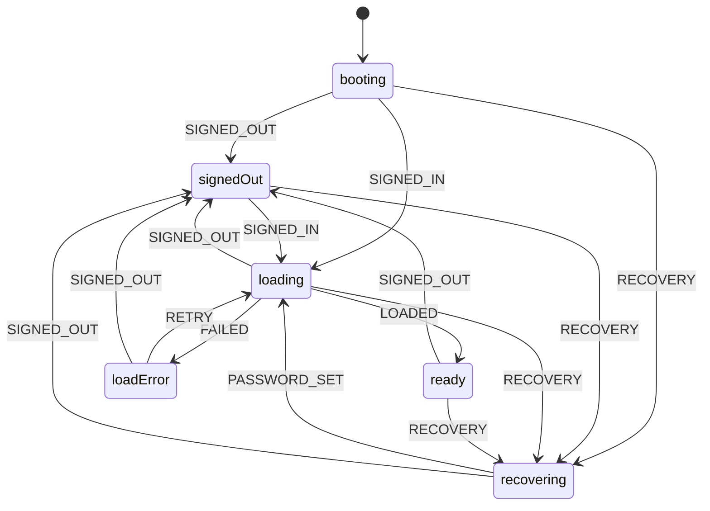

# Team Time Clock: handoff for Grok

Read this whole file before changing anything. It covers what the app is, where everything lives, how the database and security work, and the rules for keeping it working.

---

## 1. What the app does

A small employee time clock for about 9 people (3 admins, 6 employees; starting with 3 employees). It must stay **very easy to use** and **fully bilingual (English / Spanish)**.

**Employees** (role `employee`):
- Sign up / sign in with any personal email and password (forgot-password flow included)
- One big **Clock in / Clock out** button
- See hours **today**, **this week** (Mon–Sun), and **PTO hours left** this year
- Request PTO (date, hours, optional note); cancel while pending; see status
- If the connection drops, the last data stays on screen with a "No connection" notice; if the first load fails there is a "Try again" screen
- See their last ~10 shifts
- See upcoming company **holidays (days off)**, plus a notice at the top: "Next day off: X · in N days", or "Today is X. We're off" on the day

**Admins** (role `admin`) get everything above plus a **Team** tab:
- Everyone's clocked-in/out status, this week's and last week's hours, and a count of pending PTO requests
- Per person: approve or deny PTO (and **Undo** a decision, which returns it to pending), set yearly PTO allowance, view shifts for the last 90 days, delete a shift, add a missed shift (handles overnight shifts, max 16 h), force clock-out, and promote or demote admins
- Add or delete holidays

**Language:** an EN/ES toggle in the header. It is remembered in `localStorage` (`tc-lang`) and defaults to Spanish when the browser language is Spanish.

---

## 2. Where everything lives

| Thing | Location |
|---|---|
| Code (whole app) | `index.html` in GitHub repo **D1rtyChuy23/TimeClock** (branch `main`) |
| Live site | GitHub Pages: **https://d1rtychuy23.github.io/TimeClock/** (Settings → Pages → Deploy from branch `main`, `/ (root)`) |
| Backend | Supabase project **team-time-clock**, project ref `jegfqjvrntiopfufhoxi`, region us-east-2, org "D1rtyChuy23's Org" |
| Supabase URL | `https://jegfqjvrntiopfufhoxi.supabase.co` |
| Browser key | `sb_publishable_B_A8UAQMbDj5ZSitwRDlyg_oLdErUNR` (publishable key, safe to be public) |

Do not mix this up with the other Supabase project ("D1rtyChuy23's Project", ref `bbmahndmtdabrgkavyrr`). That one is a different app (KatzDesk).

**Never put the `service_role` / secret key in `index.html` or the repo.** The repo is public, and the service key bypasses all security.

---

## 3. Tech stack

- **One file**: `index.html` contains the HTML, CSS and vanilla JS. There is no build step, framework or npm. Edit it and push; Pages redeploys in about a minute.
- **supabase-js v2** loaded from CDN. The exact working URL is:
  `https://cdn.jsdelivr.net/npm/@supabase/supabase-js@2.113.0/dist/umd/supabase.js`
  The file is **`supabase.js`, not `supabase.min.js`**. A wrong filename was a real bug that made the page hang on "Loading…". If you change the version, confirm that file exists in that version's `dist/umd/` folder.
- Fonts: Google Fonts (Barlow, Barlow Condensed).
- Light and dark themes through CSS variables on `:root` plus `prefers-color-scheme`.

---

## 4. Database schema (Supabase / Postgres)

Tables in `public`, all with **Row Level Security ON**:

**profiles**: one row per user, created automatically on sign-up
- `id uuid PK → auth.users.id` (cascade delete)
- `full_name text`, `email text`
- `role text` 'admin' | 'employee' (default employee)
- `pto_allowance numeric(6,2)`: PTO hours per year (default 0)
- `created_at timestamptz`

**punches**: one row per shift
- `id bigint identity PK`, `user_id uuid → profiles.id`
- `clock_in timestamptz`, `clock_out timestamptz NULL` (NULL = currently on the clock)
- `manual boolean`: true when an admin typed it in (shown with ✎)
- `created_by uuid default auth.uid()`
- Check: `clock_out > clock_in`. A unique partial index allows **only one open punch per user**.

**pto_requests**
- `id bigint identity PK`, `user_id uuid default auth.uid()`
- `day date`, `hours numeric(5,2)` (0 < hours ≤ 24), `note text` (≤ 200 chars)
- `status` 'pending' | 'approved' | 'denied', `decided_by uuid`, `created_at`
- PTO left = `pto_allowance` − approved hours in the current calendar year (computed in the browser).

**holidays**: every row is a company **day off**
- `day date PK`, `name text` (1–60 chars)

### Functions and triggers
- `is_admin()`: true if the caller's profile role is admin (security definer). Used inside the RLS policies.
- `handle_new_user()` trigger on `auth.users` insert creates the profile from sign-up metadata `full_name`. **The very first account ever created becomes admin; everyone after is an employee.** Admins promote others in the Team tab.
- `guard_profile()` trigger blocks signed-in non-admins from changing `role`, `pto_allowance` or `email`, even on their own row, and refuses to demote the **last admin**. The Supabase SQL editor (no signed-in user) is allowed through, so the owner can repair roles there.
- `clock(action text, target uuid default null)` RPC: **the app's only way to clock in or out.** `action` is `'in'` or `'out'`; it uses the server clock (`now()`), so a wrong phone clock can't cheat. It returns `'in'`, `'out'`, `'already_in'` or `'already_out'`, so a stale screen or a second device can never flip a shift the wrong way. Only an admin may pass another user's id. **Employees cannot insert punches directly.**
- `punch(target uuid default null)`: the older toggle version. The app no longer calls it; it stays so an old cached copy of the page keeps working. Don't build on it.

### RLS policy summary
| Table | Employee | Admin |
|---|---|---|
| profiles | read/update own row (role/PTO locked by trigger) | read/update all |
| punches | read own; write only through `clock()` | read/insert/update/delete all |
| pto_requests | read own; insert own as `pending` only; delete own while pending | read all; update (approve/deny/undo); delete |
| holidays | read | full write |
| anon (signed out) | nothing (all grants revoked) | n/a |

### Full SQL (as applied, migration `time_clock_schema`)
Use this if the database ever needs to be rebuilt:

```sql
create table public.profiles (
  id uuid primary key references auth.users(id) on delete cascade,
  full_name text not null default '',
  email text,
  role text not null default 'employee' check (role in ('admin','employee')),
  pto_allowance numeric(6,2) not null default 0 check (pto_allowance >= 0),
  created_at timestamptz not null default now()
);

create table public.punches (
  id bigint generated always as identity primary key,
  user_id uuid not null references public.profiles(id) on delete cascade,
  clock_in timestamptz not null,
  clock_out timestamptz,
  manual boolean not null default false,
  created_by uuid default auth.uid(),
  check (clock_out is null or clock_out > clock_in)
);
create unique index one_open_punch on public.punches(user_id) where clock_out is null;
create index punches_user_in on public.punches(user_id, clock_in desc);

create table public.pto_requests (
  id bigint generated always as identity primary key,
  user_id uuid not null default auth.uid() references public.profiles(id) on delete cascade,
  day date not null,
  hours numeric(5,2) not null check (hours > 0 and hours <= 24),
  note text check (char_length(note) <= 200),
  status text not null default 'pending' check (status in ('pending','approved','denied')),
  decided_by uuid,
  created_at timestamptz not null default now()
);
create index pto_user on public.pto_requests(user_id);

create table public.holidays (
  day date primary key,
  name text not null check (char_length(name) between 1 and 60)
);

create function public.is_admin() returns boolean
language sql stable security definer set search_path = '' as $$
  select exists (select 1 from public.profiles where id = (select auth.uid()) and role = 'admin');
$$;

create function public.handle_new_user() returns trigger
language plpgsql security definer set search_path = '' as $$
begin
  insert into public.profiles (id, full_name, email, role)
  values (new.id, coalesce(new.raw_user_meta_data->>'full_name', ''), new.email,
          case when exists (select 1 from public.profiles where role = 'admin') then 'employee' else 'admin' end);
  return new;
end $$;
create trigger on_auth_user_created after insert on auth.users
  for each row execute function public.handle_new_user();

create function public.guard_profile() returns trigger
language plpgsql security definer set search_path = '' as $$
begin
  if not public.is_admin() and (new.role is distinct from old.role or new.pto_allowance is distinct from old.pto_allowance or new.email is distinct from old.email) then
    raise exception 'Only admins can change this';
  end if;
  return new;
end $$;
create trigger guard_profile before update on public.profiles
  for each row execute function public.guard_profile();

create function public.punch(target uuid default null) returns text
language plpgsql security definer set search_path = '' as $$
declare uid uuid := coalesce(target, auth.uid());
begin
  if auth.uid() is null then raise exception 'Not signed in'; end if;
  if uid <> auth.uid() and not public.is_admin() then raise exception 'Not allowed'; end if;
  update public.punches set clock_out = now() where user_id = uid and clock_out is null;
  if found then return 'out'; end if;
  insert into public.punches (user_id, clock_in, created_by) values (uid, now(), auth.uid());
  return 'in';
end $$;
revoke execute on function public.punch(uuid) from public, anon;
grant execute on function public.punch(uuid) to authenticated;
revoke execute on function public.is_admin() from public, anon;
grant execute on function public.is_admin() to authenticated;
revoke execute on function public.handle_new_user() from public, anon, authenticated;
revoke execute on function public.guard_profile() from public, anon, authenticated;

alter table public.profiles enable row level security;
alter table public.punches enable row level security;
alter table public.pto_requests enable row level security;
alter table public.holidays enable row level security;

create policy "read own or admin" on public.profiles for select to authenticated
  using (id = (select auth.uid()) or (select public.is_admin()));
create policy "update own or admin" on public.profiles for update to authenticated
  using (id = (select auth.uid()) or (select public.is_admin()))
  with check (id = (select auth.uid()) or (select public.is_admin()));

create policy "read own or admin" on public.punches for select to authenticated
  using (user_id = (select auth.uid()) or (select public.is_admin()));
create policy "admin insert" on public.punches for insert to authenticated with check ((select public.is_admin()));
create policy "admin update" on public.punches for update to authenticated using ((select public.is_admin())) with check ((select public.is_admin()));
create policy "admin delete" on public.punches for delete to authenticated using ((select public.is_admin()));

create policy "read own or admin" on public.pto_requests for select to authenticated
  using (user_id = (select auth.uid()) or (select public.is_admin()));
create policy "request own" on public.pto_requests for insert to authenticated
  with check (user_id = (select auth.uid()) and status = 'pending' and decided_by is null);
create policy "admin decide" on public.pto_requests for update to authenticated
  using ((select public.is_admin())) with check ((select public.is_admin()));
create policy "cancel own pending or admin" on public.pto_requests for delete to authenticated
  using ((user_id = (select auth.uid()) and status = 'pending') or (select public.is_admin()));

create policy "everyone reads" on public.holidays for select to authenticated using (true);
create policy "admin writes" on public.holidays for all to authenticated
  using ((select public.is_admin())) with check ((select public.is_admin()));

revoke all on public.profiles, public.punches, public.pto_requests, public.holidays from anon;
```

### Second migration (`explicit_state_machines`), applied on top of the SQL above

```sql
create function public.clock(action text, target uuid default null) returns text
language plpgsql security definer set search_path = '' as $$
declare uid uuid := coalesce(target, auth.uid()); n int;
begin
  if auth.uid() is null then raise exception 'Not signed in'; end if;
  if uid <> auth.uid() and not public.is_admin() then raise exception 'Not allowed'; end if;
  if action = 'in' then
    insert into public.punches (user_id, clock_in, created_by) values (uid, now(), auth.uid())
      on conflict do nothing;   -- one_open_punch index: a second open shift is a no-op
    get diagnostics n = row_count;
    return case when n = 1 then 'in' else 'already_in' end;
  elsif action = 'out' then
    update public.punches set clock_out = now() where user_id = uid and clock_out is null;
    return case when found then 'out' else 'already_out' end;
  end if;
  raise exception 'action must be in or out';
end $$;
revoke execute on function public.clock(text, uuid) from public, anon;
grant execute on function public.clock(text, uuid) to authenticated;

create or replace function public.guard_profile() returns trigger
language plpgsql security definer set search_path = '' as $$
begin
  if old.role = 'admin' and new.role <> 'admin'
     and not exists (select 1 from public.profiles where role = 'admin' and id <> old.id) then
    raise exception 'There must be at least one admin';
  end if;
  if (select auth.uid()) is not null and not public.is_admin()
     and (new.role is distinct from old.role or new.pto_allowance is distinct from old.pto_allowance or new.email is distinct from old.email) then
    raise exception 'Only admins can change this';
  end if;
  return new;
end $$;
```

The Supabase security advisor shows warnings ("signed-in users can execute SECURITY DEFINER function") for `is_admin`, `punch` and `clock`. **These are expected.** `punch` and `clock` check permissions themselves, and `is_admin` only reveals the caller's own role. Don't "fix" them by revoking execute, or the app breaks.

---

## 5. How the front end is organized (inside `index.html`)

### 5.1 State machines: read this before changing any flow

Every flow in the app is an explicit state machine. They are all declared in one table, `M`, near the top of the script. **`go(machine, EVENT)` is the only code that changes state.** An event with no entry for the current state is ignored and logged with `console.debug`. `render()` draws the whole page from the current states, so no handler shows or hides screens by hand.

To add or change a flow: edit the `M` table, then send events with `go()`. Don't add new boolean flags or toggle `hidden` from event handlers.

| Machine | States | What it controls |
|---|---|---|
| `session` | `booting` → `signedOut` / `loading` → `ready` / `loadError`; `recovering` | Who is using the page and which top-level screen shows |
| `auth` | `signin` ⇄ `signup`, `signin` ⇄ `reset` | Which sign-in form shows (`recovering` always shows the new-password form) |
| `nav` | `clock` ⇄ `team` ⇄ `person` | Which app screen shows; `team` and `person` are admin only; `S.sel` is the open person |
| `sync` | `ok` ⇄ `stale` | Whether the last background refresh worked; `stale` shows the "No connection" notice |
| `busy` | `idle` ⇄ `saving` | One save at a time; a second tap or submit while saving is ignored |



Three more machines live in the **database**, which has the final say. The page only reads them and offers the allowed moves:

| Machine | States and moves | Enforced by |
|---|---|---|
| shift (per person) | `out` → `in` → `out`, through `clock('in')` / `clock('out')` | `clock()` + the one-open-shift unique index |
| time-off request | `pending` → `approved` / `denied` (admin); `approved` / `denied` → `pending` (admin, "Undo"); `pending` → deleted (owner, "Cancel") | RLS policies. The buttons come from the `PTO` table in the script |
| role | `employee` ⇄ `admin`; first account ever becomes admin; never zero admins | `handle_new_user()` + `guard_profile()` |

Small pieces of state that are not in `M`:
- **Delete confirm:** `S.armed` holds the one delete button waiting for its second tap (for example `"delpunch:12"`). It clears after 3 seconds. See `confirmed()`.
- **Language:** `lang` is `en` or `es`, saved in `localStorage` as `tc-lang`.

`ENTER` lists what happens on arriving in a state: `session.loading` starts the data load, and `session.signedOut` clears all loaded data.

### 5.2 Reading state from outside (tests, agents, debugging)

- `<body>` carries the live state as attributes: `data-session`, `data-auth`, `data-nav`, `data-sync`, `data-busy`, plus `data-role` (`admin` / `employee`) and `data-shift` (`in` / `out`). Wait on these instead of sleeping, for example `body[data-session="ready"][data-busy="idle"]`.
- `window.timeclock` exposes `machines`, `pto` and `state`.
- Every transition is logged: `[state] session: loading -> ready (LOADED)`. Turn on "Verbose" in the browser console to see them.
- Every button has a stable `id` or `data-act` (and `data-id` for rows). Use those as selectors, not the text, which changes with the language.

### 5.3 Other pieces

- `T` object: **all UI text**, with `en` and `es` blocks. **Every new string must be added to both.** `t(key, {n:..})` fills `{n}`-style placeholders. Elements with `data-t="key"` are filled automatically.
- `S` object: loaded data and context (current user, role, people, punches, PTO, holidays, open person).
- `load()` fetches profiles, punches from the last 90 days, PTO requests, and holidays from today on, in parallel. RLS decides what each person gets back. **`refresh()` is the only caller of `load()`**: it sends the outcome to the `session` machine (first load) or the `sync` machine (later refreshes).
- `act(fn, okMsg)` runs one write behind the `busy` lock, shows a toast, then refreshes. All writes go through it.
- `clock(action, target)` calls the `clock` RPC with the direction the user saw on the button.
- Refresh: data reloads every 2 minutes, when the tab becomes visible, and when the device comes back online. There is no realtime subscription.
- Helpers `weekStart`, `hoursIn`, `ptoUsed`, `daysUntil`, plus `console.assert` self-checks that run on load (including one that checks every transition in `M` points to a real state). Keep them passing.
- Weeks run Monday–Sunday in the viewer's local time. An open shift counts up to "now".
- Auth: `signInWithPassword`, `signUp` (sends `full_name` in metadata), `resetPasswordForEmail`, and the `PASSWORD_RECOVERY` event. Supabase's auth events are mapped to `session` events at the bottom of the script. Sign-in errors tell apart a wrong password, an unconfirmed email and an unreachable server.

### 5.4 Tests

`test/run.py` drives `index.html` in headless Chromium against `test/fake-supabase.js`, a stand-in backend that follows the same rules as the real database. It checks every machine above (56 checks).

```
pip install playwright && playwright install chromium
python3 test/run.py
```

**Run it before every push.** If you change a database rule, change `fake-supabase.js` to match.

---

## 6. Setup and operations checklist

1. **Supabase → Authentication → URL Configuration**: set **Site URL** to `https://d1rtychuy23.github.io/TimeClock/` and add the same address under **Redirect URLs**. Without this, confirmation and reset emails point to the wrong place.
2. **The free plan pauses the project after about 7 days with no activity.** The site then can't sign anyone in. Fix: Supabase dashboard → project → **Restore**, or keep it in daily use. It has paused twice already.
3. **Email limits:** Supabase's built-in email sender only allows a few emails per hour. If confirmation emails don't arrive, either turn off **Confirm email** (Authentication → Sign In / Providers → Email) or set up custom SMTP.
4. **First account = admin.** The owner (Chuy) should sign up first, then promote the other 2 admins from the Team tab.

---

## 7. Rules for making changes

- Keep it **one simple page** and **super easy for employees**: big buttons, no extra steps.
- **Every user-facing string goes in both English and Spanish.**
- **Change flows through the state machine table** (section 5.1), and run `python3 test/run.py` before pushing.
- **Don't weaken security**: keep RLS on, keep clock-in on the server clock through `clock()`, never let employees write punches, roles or PTO allowances directly, and never add the service key to the browser.
- After any schema change, re-run the Supabase security advisor, and test as an employee that you **cannot** approve your own PTO, add a shift, or make yourself admin.
- Escape any user-entered text before putting it into HTML (use the existing `esc()` helper).

## 8. Not built yet (possible next steps)

- CSV / payroll export of hours
- Overtime rules and pay periods other than Mon–Sun weeks
- "Sign in with Google" (needs a Google Cloud OAuth client added in Supabase)
- Marking a holiday as "working" vs "off" (today every holiday is treated as a day off)
- Realtime updates (currently a 2-minute refresh)

## 9. Test status

- **Browser:** `test/run.py` passes 56 of 56 checks against the stand-in backend (sign-in flows, clock in/out, double taps, stale screens, time off, deletes, admin screens, lost connection, password recovery, Spanish).
- **Real database: not yet run.** The permission test for the real database (an employee trying to approve their own PTO, add a shift, make themselves admin, or clock someone else in; plus the `clock()` results and the last-admin rule) has been written but was blocked waiting for the owner's approval in Supabase. Run the checks in section 7 with two real accounts before rolling out to the team.
