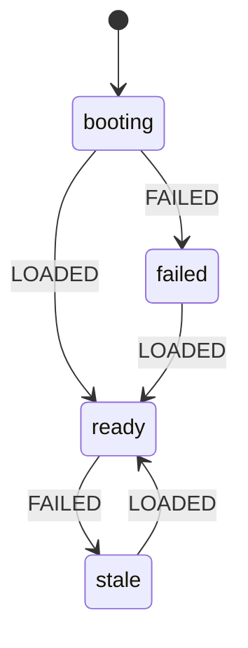

# Time Clock: handoff notes

Read this before changing anything. It describes the app as it is on this branch.

> **History:** the first version of this app was a single `index.html` backed by Supabase. It was replaced by the current app (commit "Add the Time Clock app."). The old version is still in git history and on the `state-machines` branch. The Supabase project `team-time-clock` is **not used** by this app.

---

## 1. What the app does

A time clock for a small team (about 9 people: 3 admins, 6 employees). It must stay **very easy to use** and **fully bilingual (English / Spanish)**.

**Everyone**
- Signs in with email and password (or Google / X)
- One big **Clock in / Clock out** button
- Sees hours today, hours this week (Monday–Sunday) and PTO hours left this year
- Requests PTO, and can cancel a request while it is pending, or an approved one until the day has passed
- Sees a shared calendar of shop closures and approved days off (pending requests stay private)

**Admins** also get a **Team** tab
- Who is on the clock, hours this week and last week, pending request counts
- Per person: approve or deny PTO, **Undo** a decision (back to pending), set the yearly PTO allowance, clock someone out, add a missed shift (16 hours max), delete a shift, make someone an admin or employee
- Add and delete shop closures on the calendar

The first account ever created becomes the admin.

---

## 2. Stack and layout

- **TanStack Start** (React 19, Vite, file routes in `src/routes/`), **Tailwind 4**
- **Better Auth** for sign-in (`src/lib/auth/`)
- **Postgres**: Neon when `DATABASE_URL` is set, otherwise an embedded **PGLite** database, so `npm run dev` works with nothing configured (`src/lib/db.ts`)
- SQL migrations in `migrations/`; `npm run build` runs them (`scripts/migrate.mjs`)
- Built with Grok Build. The repo does not record where it is deployed. It needs a server and a database, so it cannot run as a static GitHub Page.

### Files that are the app (change these)

| File | What it is |
|---|---|
| `src/lib/clock-machine.ts` | **The state machines.** Pure rules shared by server and screens. Start here. |
| `src/lib/timeclock.functions.ts` | Every server function (load, clock in/out, PTO, shifts, roles, closures) |
| `src/components/clock-app.tsx` | The signed-in app: My time, calendar, PTO, Team |
| `src/components/auth-screen.tsx` | Sign in / create account |
| `src/lib/i18n.tsx` | All text, English and Spanish, plus error-code-to-text maps |
| `src/lib/time.ts` | Hours and date helpers with a built-in `selfCheck()` |
| `migrations/0002_timeclock.sql` | Tables: `profiles`, `punches`, `pto_requests`, `holidays` |
| `src/routes/index.tsx`, `login.tsx` | Booting / signed out / signed in gate |

### Platform scaffold (leave alone unless you know why)

`scripts/`, `server/`, `public/__grok/`, `src/lib/auth/`, `src/lib/app-data/`, `src/lib/og/`, `src/lib/preview-*`, `src/lib/multiplayer/`, `src/components/ui/`. One deliberate change was made there: `UserButton` in `src/lib/auth/gates.tsx` takes optional `labels` so "Sign out" can be translated.

---

## 3. State machines: read this before changing any flow

The rules live in **`src/lib/clock-machine.ts`**. The server functions use them to decide what is allowed, and the screens use the same functions to decide which buttons to draw. Change a flow there, then run the tests.

| Machine | States and moves | Where it is enforced |
|---|---|---|
| **Screen** | `booting` → `ready` or `failed`; `ready` → `stale` when a refresh fails; any → `ready` on a good load | `LOAD` table + `screenReducer` in `clock-app.tsx` |
| **Shift** (per person) | `out` → `in` → `out` | `togglePunch` with an explicit `action`; the `one_open_punch` unique index |
| **Time-off request** | `pending` → `approved` / `denied` (admin); `approved` / `denied` → `pending` (admin, "Undo"); cancel = delete (owner while pending, or approved until the day passes; admin any time) | `ptoActions()` used by `decidePto`, `cancelPto` and the buttons |
| **Role** | `employee` ⇄ `admin`, never zero admins, first profile is admin | `canSetRole()` in `setRole`; `ensureProfile()` |
| **Session** | `pending` → `signed_in` / `signed_out` | `src/lib/auth/sign-in-gate.ts`, `src/routes/index.tsx` |
| **Saving** | idle ⇄ saving, one save at a time | `act()` in `clock-app.tsx` |



Things worth knowing:

- **Clock in/out names its direction.** The screen sends `action: "in"` or `"out"`. If the shift is already in that state the server answers `already_in` / `already_out` and changes nothing. A stale screen, a second device or a double tap can therefore never flip a shift the wrong way. (`togglePunch` still flips when no `action` is sent, only so a page loaded before this change keeps working. Always send `action`.)
- **`failed` and `stale` are different.** `failed` means nothing has loaded yet: a full card with "Try again". `stale` means a later refresh failed: the last good data stays on screen under a "No connection" notice.
- **One save at a time.** `act()` ignores a second save while one is running and resolves `true` only when the save worked, so forms clear only on success. After a refused save it reloads, because a refusal usually means the screen was out of date.
- **Newest answer wins.** Every load and save takes a ticket; an answer that is no longer the newest request is dropped, so a slow background refresh cannot paint over the result of a save.
- **A decided PTO request must be reopened before it can be decided again.** If two admins act on the same request, the second gets the `changed` error and fresh data instead of silently overwriting the first.
- **Confirm-before-delete** states are small local `id | null` values in the component that owns the list (`confirmId`, `confirmHoliday`, `confirmPto`, `confirm`). They are deliberately not in the shared module.

### Reading state from outside (tests, agents, debugging)

The root element of the signed-in app carries the live state. Wait on these instead of sleeping:

| Attribute | Values |
|---|---|
| `data-status` | `booting`, `failed`, `ready`, `stale` |
| `data-busy` | `true`, `false` |
| `data-tab` | `mine`, `team` |
| `data-role` | `admin`, `employee` |
| `data-shift` | `in`, `out` |

Example: `[data-status="ready"][data-busy="false"]`. PTO decision buttons carry `data-action="approve" | "deny" | "reopen"`. Stable ids: `#clock-btn`, `#pto-request`, `#pto-day`, `#pto-hours`, `#pto-note`, `#holiday-name`, `#auth-submit`, `#name`, `#email`, `#password`. Prefer these to visible text, which changes with the language.

---

## 4. Server functions (`src/lib/timeclock.functions.ts`)

Every function runs behind `authMiddleware`, takes the caller's id from the session (never from the request), and reads the caller's role from the database. Admin-only functions call `requireAdmin()`.

- Writes return `{ ok: true, data: Snapshot }` or `{ ok: false, error: code }`. Add new codes to `CODES` **and** to `ERROR_KEYS` in `i18n.tsx`, with text in both languages.
- `loadClock` returns the `Snapshot`: employees get only their own profile, shifts and requests; admins get everyone's. `offDays` (approved time off, no notes) and `holidays` go to everyone.
- Clock in/out uses the database clock (`now()`), so a wrong phone clock cannot change a punch.

---

## 5. Running and checking

```
npm install
npm run dev          # http://127.0.0.1:8080, embedded database, real sign-up works
npm run typecheck
npm run lint
```

Unit tests for the app code:

```
node --experimental-strip-types --test src/lib/app-data/app-data.test.ts src/lib/app-data/readiness-schedule.test.ts src/lib/auth/gate-identity.test.ts src/lib/auth/sign-in-gate.test.ts src/lib/preview-path-prefix.test.ts src/lib/clock-machine.test.ts
```

`npm test` runs the scaffold's script tests first. Outside a Grok Build workspace 17 of those fail because they read `.grok/` files that are not in this repository, and `npm test` then stops before it reaches the app tests. Use the command above to run the app tests on their own.

---

## 6. Rules for changes

- Keep it simple for employees: one obvious button, no extra steps.
- **Every user-facing string goes in `en` and `es`** in `i18n.tsx`. The `es` table is typed against `en`, so a missing translation fails `npm run typecheck`.
- **Change flows in `clock-machine.ts`**, add a case to `clock-machine.test.ts`, and let the server and the screen both read the rule from there. Do not re-implement a rule in a component.
- Never trust the client for who someone is or what role they hold.
- Keep clock in/out on the database clock, and keep sending `action`.

## 7. Known gaps

- There is no "forgot password" flow. It needs outgoing email to be set up first.
- No CSV or payroll export, no overtime rules, no pay periods other than Monday–Sunday weeks.
- Two people signing up at the same instant as the very first accounts could both become admin. The Team tab can fix it.
- Missed shifts added by an admin are not checked for overlap with existing shifts.

## 8. Test status

- App unit tests: 66 of 66 pass (7 of them cover the state machines).
- End to end, in a headless browser against `npm run dev` with real sign-up and the embedded database: 26 of 26 checks passed on 2026-11-09. Covered: sign-up, first account is admin, clock in/out, triple tap, a stale second screen, double PTO submit, approve / undo / deny, promote and demote, lost connection, failed first load and retry, Spanish, and sign-in error messages.
- Not tested: a deployed build on Neon, and Google / X sign-in.
